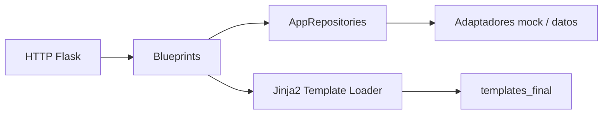

# Flask Portfolio Architecture Study — Jinja2 y Repository Pattern

**Estudio técnico de una aplicación de portafolio/blog escrita en Flask** que explora separación entre rutas, DTO, repositorios de datos y plantillas Jinja2. El código conserva antecedentes de un proyecto referenciado como `Daniel117622`; **la procedencia y licencia de los componentes originales deben verificarse** antes de redistribuirlos.

> **Estado:** arquitectura en migración, no aplicación lista para producción ni evidencia de una integración MongoDB desplegada.

## Arquitectura observada



| Ruta | Propósito |
|---|---|
| [`app.py`](app.py) | Factoría de aplicación y configuración de rutas |
| [`routes/`](routes/) | Blueprints de HTTP |
| [`repository/`](repository/) | Abstracciones y repositorios de datos |
| [`dtos/`](dtos/) | Estructuras de transferencia |
| [`loader.py`](loader.py) | Loader de plantillas para migración |
| [`templates_final/`](templates_final/) | Plantillas Jinja2 incorporadas a Git |
| [`requirements.txt`](requirements.txt) | Dependencias Python fijadas |
| [`docs/`](docs/) | Evaluación y escalabilidad |

## Instalación local

**Requisitos:** Python 3 y entorno virtual. Para probar sin publicar servicios:

```bash
python -m venv .venv
python -m pip install -r requirements.txt
python -m flask --app app run --host 127.0.0.1 --port 8000
```

Abrir `http://127.0.0.1:8000/`. Si se utiliza una ruta `/migration/`, la aplicación puede depender de `templates_original/`, directorio ignorado deliberadamente en Git y que **no está disponible en un clon limpio**.

**Advertencia:** ejecutar directamente `python app.py` activa `debug=True` y enlaza a `0.0.0.0` en la versión observada. Es un modo de desarrollo que no debe exponerse a Internet.

## Límites y seguridad

- Los repositorios mock permiten revisar interfaces sin conexión real; no presuponen que MongoDB esté operando.
- Evitar publicar contenido original no migrado, secretos, fotos de terceros o datos reales en ejemplos.
- Confirmar autoría, licencia y permisos de los assets y archivos heredados antes de derivar un producto de MasterTech.
- Probar rutas, errores, plantillas, CORS y persistencia en un entorno aislado antes de hablar de despliegue.

## Evolución

Añadir tests con Flask test client, normalizar dependencias, documentar configuración por entorno y revisar con claridad el cambio entre mocks y adapters reales. Si se valida un uso público, configurar servidor WSGI/ASGI, proxy TLS, logs y copias de seguridad.

[Plan técnico](docs/ENGINEERING_ROADMAP_2026-11-04.md) · [Arquitectura y escalabilidad](docs/ARCHITECTURE_SCALABILITY_2026-11-04.md).

**Créditos y derechos:** estudio de aprendizaje con posible material de terceros, sin transferencia automática de titularidad.
